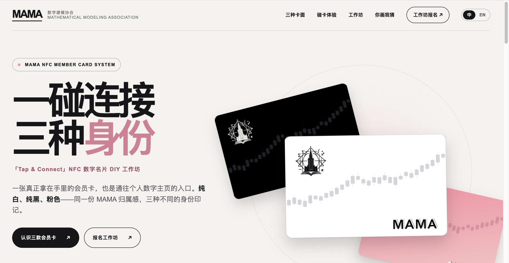
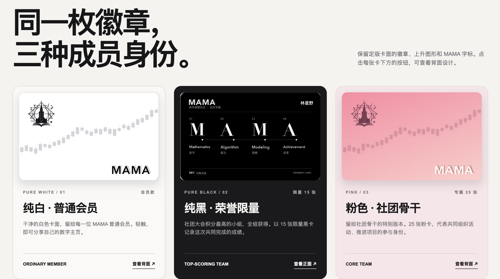
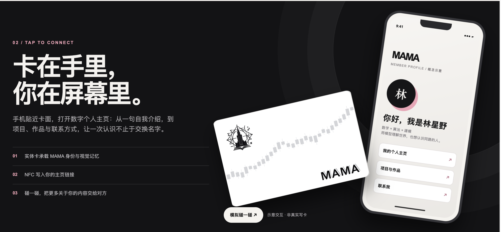

# Tap & Connect · NFC 数字名片

**一张拿在手里的 MAMA 会员卡，也是通往个人数字主页的入口。** Tap & Connect 是深圳北理莫斯科大学数学建模协会（MAMA）的 NFC 数字名片与个人网站创作项目。成员可以将自己的公开主页网址写入卡片：碰一碰，便能分享自我介绍、项目作品与联系方式。

🌐 [打开宣发网站](https://tap.lingozm.cn/) · 🎮 [打开「你画我猜」游戏](https://tap.lingozm.cn/game.html)

## 三种卡面，一种连接方式

卡面将数学建模中的图形、数据走势与校园视觉元素结合，采用统一的 MAMA 设计语言。纯白款面向普通会员；纯黑款限量 **15 张**，由社团大会积分最高的小组全组获得；粉色款为社团骨干专属，共 **25 张**。卡片背面的姓名区域按持卡人定制，图中的“林星野”是页面示例姓名。

## 从实体名片到数字主页

工作坊的核心是让成员学习如何整理个人内容，借助 AI Agent 构建自己的博客或作品展示网站，理解并调整生成的 HTML、CSS 与交互代码，再把源码上传 GitHub、发布可公开访问的页面。完成后将个人网址写入 NFC 卡片，用不同手机测试。网站内容可以继续更新，卡片仍可指向同一入口。

项目希望让中俄同学通过双语自我介绍和作品展示更容易认识彼此，也让参与者留下可用于竞赛组队、求职和升学展示的实践作品。个人主页展示哪些信息，由持卡人自行决定。

## 仓库内容

| 文件 | 作用 |
| --- | --- |
| `index.html` | 中英双语项目宣发主页：三款卡面、碰卡概念演示、工作坊介绍与报名入口。 |
| `game.html` | 「你画我猜」互动游戏：中文与俄语词库、抽号转盘、计时和计分。 |
| `assets/` | README 使用的三张项目展示截图。 |

两个网页均为独立 HTML 文件，样式、脚本与网页图像已内嵌。下载仓库后直接打开 `index.html` 即可预览，主页导航可进入游戏页。README 截图是宣发页面的视觉展示；其中手机上的个人主页属于**概念示意**，每位成员的网站将在工作坊中分别创建。

## 项目进度与部署

本仓库保存当前网站文件与展示截图；公开演示站点位于 [tap.lingozm.cn](https://tap.lingozm.cn/)。GitHub 仓库为私人仓库，更新仓库文件不会自动更新现有线上站点。工作坊的具体时间、卡片制作与领卡安排以社团正式通知为准。
